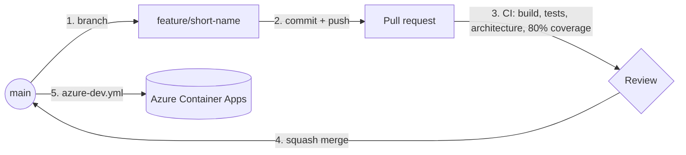

# Contributing

This repository follows **[GitHub Flow](https://docs.github.com/en/get-started/using-github/github-flow)**:
`main` is always deployable, every change goes through a short-lived branch and a pull request, and
whatever is merged to `main` is deployed.



## 1. Branch from `main`

```bash
git switch main && git pull
git switch -c feature/volcano-photos
```

| Prefix | For |
|---|---|
| `feature/` | New behaviour (starts with a spec, see below) |
| `fix/` | A defect |
| `docs/`, `chore/`, `ci/` | Documentation, maintenance, pipelines |
| `NNN-name` | Spec Kit feature branches created by `/speckit-specify` |

Keep branches small and short-lived (days, not weeks). Rebase on or merge `main` often.

## 2. Spec first for new behaviour

New behaviour starts as a numbered spec in [`specs/`](specs/README.md):
`/speckit-specify` → `/speckit-clarify` → `/speckit-plan` → `/speckit-tasks` → `/speckit-implement`.
The plan must pass the Constitution Check in [`.specify/memory/constitution.md`](.specify/memory/constitution.md).
Fixes and maintenance do not need a spec.

## 3. Commit

Use [Conventional Commits](https://www.conventionalcommits.org/): `feat(geo): ...`, `fix(volcano): ...`,
`docs: ...`, `test: ...`, `ci: ...`, `build: ...`, `refactor: ...`. Say *why* in the body.

Before pushing, run what CI runs:

```bash
dotnet build DiscoverCostaRica.sln -c Release          # warnings are errors
dotnet test DiscoverCostaRica.sln -c Release --no-build --filter "Category!=RequiresAzure" --settings coverage.runsettings
```

Docker must be running (SQL Server and Redis start in Testcontainers).

## 4. Open a pull request against `main`

- Fill in the template: what changed, why, how it was tested, and the spec or issue it implements.
- CI (`ci.yml`) must be green. It runs the build, every test suite, the architecture rules and the 80% line/branch coverage gate.
- Do not change the v1 response shape. The characterization tests pin it byte for byte; a breaking change needs a new API version.
- Do not add lines to `tests/DiscoverCostaRica.ArchitectureTests/architecture-baseline.txt`. Fix the violation instead.
- At least one approving review (`CODEOWNERS` requests it automatically).

## 5. Merge and deploy

**Squash and merge**, so `main` gets one Conventional Commit per pull request, then delete the branch.
Each push to `main` runs `azure-dev.yml`: CI again, then `azd provision` and `azd deploy`. Deployments
run one at a time. If `main` breaks, revert the merge commit through a pull request; don't push to `main` directly.

## Repository settings (maintainers)

GitHub Flow relies on these settings. They live in GitHub, not in the code:

- **Settings → Rules → Rulesets → New branch ruleset** for `main`:
  - Restrict deletions; block force pushes.
  - Require a pull request before merging, with 1 approval, dismissal of stale approvals, review from Code Owners, and resolution of conversations.
  - Require status checks to pass: `build-and-test` (from `ci`), with branches up to date before merging.
- **Settings → General → Pull Requests**: allow squash merging only, and turn on *Automatically delete head branches*.
