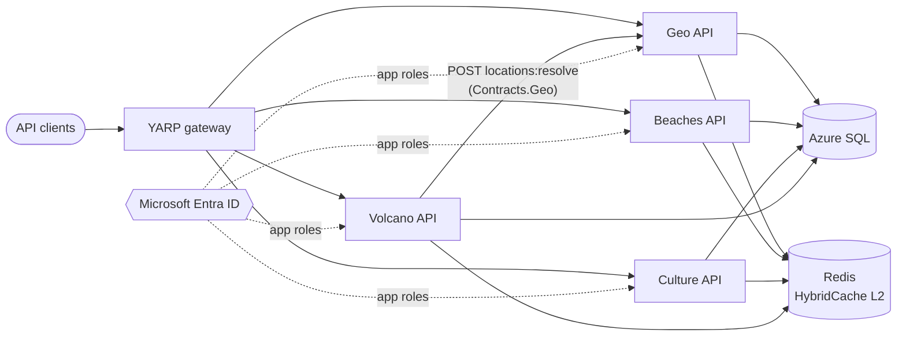

# Discover Costa Rica

[](https://github.com/LuisiitoDev/DiscoverCostaRica/actions/workflows/ci.yml)
[](https://github.com/LuisiitoDev/DiscoverCostaRica/actions/workflows/azure-dev.yml)

Tourism catalog APIs for Costa Rica (provinces, cantons and districts, beaches, volcanoes, traditions and dishes) built as **.NET 10 microservices** on **Clean Architecture**, orchestrated with **.NET Aspire** and deployed to **Azure Container Apps**.

The project is developed **spec-first** with [GitHub Spec Kit](https://github.com/github/spec-kit). Its rules live in a [constitution](.specify/memory/constitution.md) and are enforced by tests in CI:

| Quality gate | How it is enforced |
|---|---|
| Dependency Rule (Clean Architecture) | 11 architecture tests over the project graph and the IL; the [baseline](tests/DiscoverCostaRica.ArchitectureTests/architecture-baseline.txt) of known violations is empty |
| Frozen v1 HTTP contract | Characterization tests compare exact response bytes, against a real SQL Server |
| Tests | 207 tests in 9 suites run on every pull request; SQL Server and Redis run in Testcontainers |
| Code coverage | CI fails below **80%** line or branch coverage (currently ~96% line, ~90% branch on CI) |
| Build hygiene | Warnings are errors, NuGet audit, central package versions, no pre-release packages |

## Architecture



Every service has the same four projects, one per Clean Architecture circle. Dependencies only point inward:

| Project | Circle | Contains | May depend on |
|---|---|---|---|
| `*.Domain` | Entities | Entities and value objects with their invariants (e.g. `CantonCode`: a canton number is unique only inside its province) | nothing |
| `*.Application` | Use cases | One interactor per behaviour (`GetProvinces`, `GetVolcanoById`, ...), the ports they own (`IGeoReadRepository`, `IGeoLocationGateway`), caching decorators | Domain, `BuildingBlocks.Application`, `Contracts.*` |
| `*.Infrastructure` | Frameworks & drivers | EF Core rows and repositories, the typed HTTP client for Geo | the inner circles |
| `*.Api` | Interface adapters + Main | Thin endpoints, the v1 presenter, `Program.cs` as composition root | everything of its own service |

Shared building blocks, split by reason to change:

- **`BuildingBlocks.Application`**: `Result<T>`, `Error`, `IUseCase<TRequest, TResponse>`, and `CachedUseCase<,>` (HybridCache, failures never cached, stampede protected).
- **`BuildingBlocks.Web`**: the v1 envelope presenter, API versioning, Entra ID authentication and the app-role policies.
- **`BuildingBlocks.Infrastructure`**: the client-credentials token provider, the EF Core registration and the hybrid cache (in-memory L1 plus Redis L2).
- **`Contracts.Geo`**: the only thing another service may reference from Geo.
- **`SourceGenerators`**: compile-time DI registration (`[TransientService]`, `[DecoratorService]`, ...) and authorization policies.

Design decisions and their trade-offs: [research.md](specs/006-clean-architecture-migration/research.md) and the [plan](specs/006-clean-architecture-migration/plan.md).

## API (v1)

All routes need a bearer token from Entra ID carrying the service's app role (`Geo.Read`, `Beaches.Read`, `Culture.Read`, `Volcano.Read`). Without a token the answer is 401; with the wrong role it is 403. Responses use the v1 envelope `{ "value": ..., "statusCode": 200 }`, or `{ "statusCode": 404, "message": "..." }` on errors.

| Service | Routes (under `/api/v1`) | Gateway |
|---|---|---|
| Geo | `GET /geo/provinces`, `/geo/provinces/{p}`, `/geo/provinces/{p}/cantons[/{c}]`, `/geo/provinces/{p}/cantons/{c}/districts[/{d}]`, `/geo/cantons/{p}[/{c}]`; deprecated `/geo/districts/{c}[/{d}]` (send `?provinceId=`); internal `POST /geo/locations:resolve` (up to 200 locations) | `/provinces`, `/cantons`, `/districts` |
| Beaches | `GET /beaches` | `/beaches` |
| Culture | `GET /traditions/tradition`, `GET /traditions/dish` | `/tradition`, `/dish` |
| Volcano | `GET /volcanoes`, `/volcanoes/{id}`, `/volcanoes/province/{p}`, each with the location names | `/volcanoes`, `/volcano`, `/province` |

The full frozen contract is in [contracts/public-api-v1.md](specs/006-clean-architecture-migration/contracts/public-api-v1.md). Each service also serves interactive docs at `/docs` (Scalar) and OpenAPI at `/openapi/v1.json`.

**Operations**
- **Health:** `GET /alive` (liveness) and `GET /health` (readiness: SQL and Redis) are served in every environment, without authentication.
- **Telemetry:** OpenTelemetry traces, metrics and logs are exported over OTLP (`OTEL_EXPORTER_OTLP_ENDPOINT`).
- **Resilience:** every outbound call goes through retry, circuit breaker and timeouts. If Geo is down, volcanoes are still served, with the last known location names.

## Getting started

Prerequisites: the .NET 10 SDK (pinned in `global.json`) and Docker.

```bash
# Run everything with the Aspire dashboard
dotnet run --project DiscoverCostaRica.AppHost

# Run the tests (SQL Server and Redis start in Testcontainers; no Azure needed)
dotnet test DiscoverCostaRica.sln --filter "Category!=RequiresAzure" --settings coverage.runsettings

# Coverage report and the 80% gate, exactly as CI runs them
dotnet tool restore
dotnet reportgenerator -reports:"**/TestResults/**/coverage.cobertura.xml" -targetdir:coverage -reporttypes:"Html;Cobertura" "-filefilters:-*.g.cs"
eng/check-coverage.sh coverage/Cobertura.xml 80
```

The AppHost needs these parameters (user secrets or `azd` environment):

| Parameter | Used for |
|---|---|
| `existingSqlServerName`, `existingSqlServerResourceGroup` | Existing Azure SQL server |
| `ConnectionStrings:redis` | Redis |
| `azureinstance`, `azuretenant`, `azureapplication`, `azureaudience` | Validating incoming Entra ID tokens |
| `azureclient`, `azuresecret`, `azurescope` | Volcano's client-credentials token for Geo |

### Test suites

| Suite | What it guards |
|---|---|
| `tests/DiscoverCostaRica.ArchitectureTests` | The Dependency Rule, as a ratchet ([how it works](tests/DiscoverCostaRica.ArchitectureTests/README.md)) |
| `tests/DiscoverCostaRica.CharacterizationTests` | The v1 contract of every service, byte for byte, plus outages, caching and health probes |
| `tests/DiscoverCostaRica.IntegrationTests` | EF Core migrations (no pending model changes) and the Redis-backed hybrid cache |
| `tests/DiscoverCostaRica.*.UnitTests` | Entities, interactors, the Geo gateway, the presenter and the source generators |
| `tests/DiscoverCostaRica.AppHost.Tests` | The gateway route table (`Category=Gateway`); end-to-end with real Azure resources (`Category=RequiresAzure`) |

## CI/CD

The repository follows **GitHub Flow**: every change reaches `main` through a pull request, and whatever is on `main` is deployed.

| Workflow | Runs on | What it does |
|---|---|---|
| [`ci.yml`](.github/workflows/ci.yml) | Every pull request, every push to `main`, and as the first job of `azure-dev` | Installs the SDK from `global.json`, builds Release with warnings as errors, runs every suite except `Category=RequiresAzure` with coverage, writes the coverage summary to the job summary, enforces the 80% gate, and uploads the test results and the HTML report (`test-results` artifact, kept 14 days) |
| [`azure-dev.yml`](.github/workflows/azure-dev.yml) | Push to `main`, or run by hand | Runs `ci.yml` first, then signs in to Azure with OpenID Connect (no stored password) and runs `azd provision` and `azd deploy`. Only one deployment runs at a time, and a running deployment is never cancelled |

Dependabot opens weekly pull requests for NuGet packages (grouped: Aspire, EF Core, ASP.NET Core, OpenTelemetry, testing) and for GitHub Actions.

**Deployment settings** (repository *Settings → Secrets and variables → Actions*):

| Kind | Name | Holds |
|---|---|---|
| Variable | `AZURE_CLIENT_ID`, `AZURE_TENANT_ID`, `AZURE_SUBSCRIPTION_ID` | The identity that deploys: an app registration with a federated credential for this repository |
| Variable | `AZURE_ENV_NAME`, `AZURE_LOCATION` | The azd environment name and the Azure region |
| Variable | `AZURE_AZUREINSTANCE`, `AZURE_AZURETENANT`, `AZURE_AZUREAPPLICATION`, `AZURE_AZUREAUDIENCE`, `AZURE_AZURECLIENT`, `AZURE_AZURESCOPE` | The Entra ID values of the AppHost parameters |
| Secret | `AZURE_AZURESECRET` | Volcano's client secret |
| Secret | `AZURE_EXISTING_SQL_SERVER_NAME`, `AZURE_EXISTING_SQL_SERVER_RESOURCE_GROUP` | The existing Azure SQL server |
| Secret | `AZURE_REDIS` | The Redis connection string |

`azd pipeline config` creates the identity, its federated credential and its role assignments, and sets the variables. The identity needs roles on the subscription; by default azd assigns Contributor and User Access Administrator (`--principal-role`). If `azd provision` fails with `failed getting subscription`, the identity signed in but has no role on `AZURE_SUBSCRIPTION_ID`.

## Repository layout

```text
.specify/                 Spec Kit: constitution, templates, scripts
specs/                    Specifications: 001-005 reverse-engineered baselines, 006 Clean Architecture migration
src/BuildingBlocks/       Application, Web and Infrastructure building blocks
src/Contracts/            Published service contracts (Contracts.Geo)
src/DiscoverCostaRica.*/  Geo, Beaches, Culture, Volcano: Domain / Application / Infrastructure / Api
DiscoverCostaRica.AppHost/          Aspire orchestration and the YARP gateway route table
DiscoverCostaRica.ServiceDefaults/  Aspire defaults: telemetry, health, discovery, resilience
DiscoverCostaRica.SourceGenerators/ Compile-time DI and policy registration
tests/                    Unit, architecture, characterization, integration and gateway tests
eng/                      Build scripts (coverage gate)
docs/                     Original architecture notes (superseded by specs/006)
.github/                  Workflows (ci, azure-dev), pull request template, CODEOWNERS, Dependabot
```

## Spec-Driven Development

Work follows Spec Kit's flow: `/speckit-specify` → `/speckit-clarify` → `/speckit-plan` → `/speckit-tasks` → `/speckit-implement`. The existing system was reverse-engineered into specs 001-005. The characterization tests then confirmed or withdrew every suspected defect before any refactoring started. See [specs/README.md](specs/README.md).

## Roadmap

Spec 006 is done except for these items (see [tasks.md](specs/006-clean-architecture-migration/tasks.md)):

- **Deploy through the AppHost.** `azure.yaml` still deploys the four APIs on their own (azd "compose" mode): the gateway is not deployed, and the APIs get no SQL, Redis or Entra ID settings, so they stop at startup. Pointing `azure.yaml` at `DiscoverCostaRica.AppHost` makes azd use the AppHost model and the parameters above. Then commit the generated Bicep (`azd infra gen`, T064).
- **Each service owns its data (US6).** Move the tables into per-service SQL schemas (`geo`, `beach`, `culture`, `volcano`) with one database user per service (T055 to T057).
- **Check the success criteria.** Run `/speckit-analyze` and record SC-001 to SC-006 in the quickstart (T065).

## Contributors

- **Luis (LuisiitoDev)**: [@LuisiitoDev](https://github.com/LuisiitoDev), project creator and lead developer

Contributions follow **GitHub Flow**: branch from `main`, open a pull request, merge once CI is green and the change is reviewed, and `main` deploys. See [CONTRIBUTING.md](CONTRIBUTING.md).

## License

The project has been described as MIT-licensed, but the repository has no `LICENSE` file yet. Add one to make a license apply.
